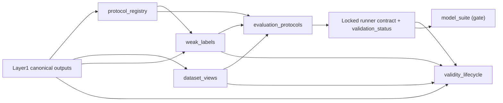
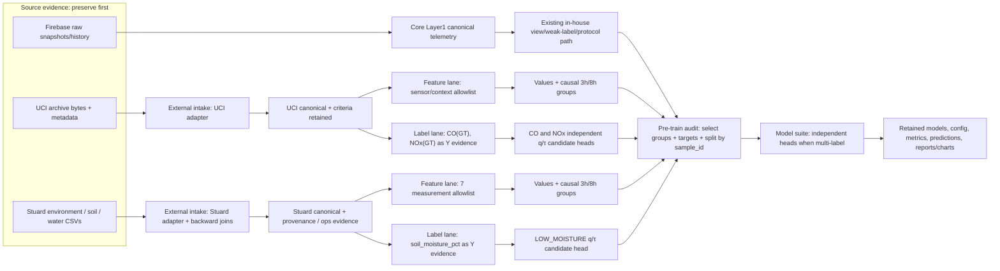
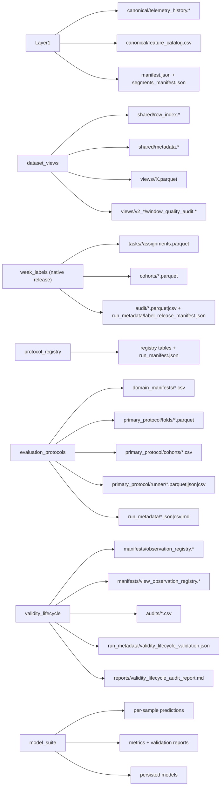

# Backend Pipeline Flow

## Purpose

This document describes the implemented handoffs from source ingestion to
canonical telemetry and from canonical telemetry into research evaluation.
The operational lane and benchmark lane are connected by artifacts but have
different owners and release gates.

## Naming note

- Older high-level docs refer to the processing lane as `Core` or
  `Backend/Navigation/Core/`.
- In the current workspace, that code is the installable package
  `src/agrifusion/` (`ingest` = Layer0, `canonical` = Layer1).
- When reading the implementation, follow the actual directory tree in
  the workspace.

## End-to-end flow

```mermaid
flowchart TD
    A["CLI: agrifusion (src/agrifusion/cli.py)"] --> B["Layer0IngestionPipeline.run()"]
    B --> C["Verbatim record store in output/Layer0 (ingest.record_store)"]
    C --> D["PreprocessingPipeline.run(): record_store reader -> firmware adapter -> rows"]
    D --> E["Canonical Layer1 artifacts in output/Layer1"]

    E --> PR["core/protocol_registry: E1/E2/E3, stage authorities, fold policy"]
    E --> DV["core/dataset_views: feature views X + superset"]
    PR --> WL["core/weak_labels (phase C native engine): label release y"]
    E --> WL
    PR --> EP["core/evaluation_protocols: folds, cohorts, runner contract"]
    DV --> EP
    WL --> EP
    EP --> RC["runner contract + protocol_validation_report.json (validation_status)"]
    RC --> VL["core/gates/validity_lifecycle: re-audit locked sample universe"]
    RC --> G{"model_suite training gate: validation_status == ready?"}
    G -- yes, or --allow-unaudited (recorded) --> MS["core/model_suite: fit, metrics, predictions, plots"]

    X["external source files"] --> XI["external/intake"]
    XI --> XF["external/features"]
    XI --> XL["external/labels"]
    XI --> XS["external/splits"]
    XL --> XA["external/support_audit"]
    XS --> XA
    XF --> PA["core/gates/pretrain_audit: select groups, key checks"]
    XL --> PA
    XS --> PA
    XA --> PA
    PA -- "audit_status = ready_for_model_policy_review" --> ML["core/model_suite/multilabel"]

    PH["experiments/weak_labels_phases (phase A readiness, phase B contract)"] -. files .-> WL
    EXP["experiments/* (k_window_variants, wade_calibration, ...)"] -. read runs via inputs.yaml .-> MS
```

All research commands run through one CLI: `python -m agrifusion_research <stage>` (see
`research/agrifusion_research/README.md`). Research outputs go to
`output/research/<lane>/artifacts/<run_id>/`.

## What each stage owns

- `src/agrifusion` (`agrifusion` CLI): Layer0 (`ingest`) and Layer1 (`canonical`) only; never
  imports the research package.
- `src/agrifusion/ingest`
  - fetches or loads raw telemetry and decides sync behavior
  - stores every record verbatim, hashed, immutable, byte-deterministic
    (no translation; run metadata only in `runs/` and `new_raw/` state files)
- `src/agrifusion/canonical`
  - reads ingest output only through `agrifusion.ingest.record_store`
  - translates firmware records (`canonical/adapters`: schema v2 -> packet view; v1 as is)
  - builds canonical telemetry history, attaches continuity and temporal fields
  - writes reports and compatibility outputs
- `core/protocol_registry`: E1/E2/E3 environment intervals, which stage may read which
  environment, 7-day/5-day fold policy. Imports no later lane.
- `core/dataset_views`: feature matrices and a row-identified superset from canonical Layer1.
- `core/weak_labels`: label authority from canonical Layer1 through the native engine
  (phase C). The frozen phase A/B decision code is in `experiments/weak_labels_phases`.
- `core/evaluation_protocols`: benchmark framing, folds, and the frozen runner contract;
  writes `validation_status`. It does not fit models.
- `core/gates/validity_lifecycle`: lifecycle evidence for E1/E2/E3 on the locked sample
  universe; creates no new splits.
- `core/gates/pretrain_audit`: explicit feature-group selection and sample-key checks across
  features, labels and splits before fitting.
- `core/model_suite`: all model fitting (protocol jobs, smoke/full staged training,
  multilabel heads), metrics, plots. Refuses an unaudited runner contract.
- `external/*`: the external-dataset pipeline (intake, features, labels, splits,
  support_audit, claims), configured by `external/datasets.py`.
- `experiments/*`: one-off studies; nothing in core or external imports them.

## Benchmark block diagram



## Data processing and target generation at a glance

The external pack follows two parallel authorities after intake: the feature
lane builds X from observed sensor/context measurements, while the label lane
builds candidate Y from its profile's target evidence. The lanes only meet at
the pre-train audit through `sample_id`.



### Read the diagram with these boundaries

- Raw intake and canonicalization preserve source fields; they do not create
  benchmark labels or model features.
- A field can be retained in canonical data yet forbidden in X. UCI analyzer
  criteria are the current example: used for candidate Y, excluded from X.
- Features, labels, and split manifests stay physically separate and are
  reconciled by stable `sample_id` in the audit.
- Candidate-label and feature profiles are declared per dataset in
  `external/datasets.py`. The claim inventory informs human review, but approved
  claim IDs are not yet an enforced runtime gate. Candidate output is not a frozen
  target release.
- The multilabel runner requires a ready pre-train audit. The in-house scalar
  model suite requires `validation_status: ready` from evaluation_protocols; it does
  not require a validity_lifecycle or pre-train audit run.

This is the current connection order:

- `dataset_views` owns feature materialization.
- `protocol_registry` owns environments, stage authorities and fold policy.
- `pretrain_audit` owns explicit group selection and keyed pre-fit checks.
- `weak_labels` owns label authority.
- `evaluation_protocols` owns benchmark framing and runner-facing
  manifests.
- `validity_lifecycle` owns pre-training readiness and ambiguity audits
  on top of that frozen contract.
- `model_suite` owns actual model fitting and held-out evaluation.

## Handoff files that matter

- Layer0 -> Layer1 (format owned by `src/agrifusion/ingest/record_store.py`)
  - `output/Layer0/Firebase_data/records/**` (verbatim records + `index.json`)
  - `output/Layer0/Firebase_data/new_raw/latest.json`, `latest_meta.json`
  - no in-memory handoff: a full run and `--only-layer1` read the same files
- Layer1 -> benchmark lanes
  - `output/Layer1/canonical/telemetry_history.parquet`
  - `output/Layer1/canonical/feature_catalog.csv`
  - `output/Layer1/manifest.json`
  - `output/Layer1/segments/segments_manifest.json`
- `dataset_views` -> `evaluation_protocols`
  - `artifacts/<run_id>/shared/row_index.*`
  - `artifacts/<run_id>/views/<view_id>/X.parquet`
  - `artifacts/<run_id>/views/<view_id>/feature_columns.json`
- `weak_labels` (native label release) -> `evaluation_protocols`
  - `run_metadata/label_release_manifest.json` (lists each task's label file)
  - `tasks/point/assignments.parquet` and the other `tasks/<task>/` label files
  - `cohorts/intrinsic_eligibility.parquet`, `cohorts/semantic_fold_projection_manifest.parquet`
- `evaluation_protocols` -> `model_suite`
  - `primary_protocol/runner/task_view_registry.csv`
  - `primary_protocol/runner/task_training_manifest.parquet`
  - `primary_protocol/runner/comparison_training_manifest.parquet`
  - `primary_protocol/runner/frozen_target_manifest.parquet`
  - `primary_protocol/runner/runner_contract.json`
  - `run_metadata/protocol_validation_report.json` (`validation_status`, training gate)
- `evaluation_protocols` -> `validity_lifecycle`
  - `run_metadata/run_manifest.json`
  - `run_metadata/protocol_validation_report.json`
  - `domain_manifests/deployment_domains.csv`
  - `primary_protocol/runner/task_view_registry.csv`
  - `primary_protocol/runner/task_training_manifest.parquet`
  - `primary_protocol/runner/comparison_training_manifest.parquet`
  - `primary_protocol/runner/frozen_target_manifest.parquet`
- `dataset_views` -> `validity_lifecycle`
  - `shared/metadata.parquet`
  - `shared/row_index.parquet`
  - `views/v1_sensor_row/X.parquet`
  - `views/v2_* / window_quality_audit.parquet`
- `weak_labels` -> `validity_lifecycle`
  - the native label release referenced by the protocol run (see above)

## Stage Output Map



## Read order for a new maintainer

1. `src/agrifusion/cli.py`
2. `src/agrifusion/ingest/FLOW.md`
3. `src/agrifusion/canonical/FLOW.md`
4. `research/agrifusion_research/README.md`, then `core/README.md`
5. `research/agrifusion_research/core/protocol_registry/FLOW.md`
6. `research/agrifusion_research/core/dataset_views/FLOW.md`
7. `research/agrifusion_research/core/weak_labels/FLOW.md`
8. `research/agrifusion_research/core/evaluation_protocols/FLOW.md`
9. `research/agrifusion_research/core/gates/validity_lifecycle/FLOW.md`
10. `research/agrifusion_research/core/model_suite/FLOW.md`
11. `research/agrifusion_research/core/BENCHMARK_TO_MODEL_SUITE_SPEC.md`
12. `research/agrifusion_research/external/README.md`, `experiments/README.md`

## Practical documentation convention

- `README.md`
  - boundary, scope, and artifact summary
- `FLOW.md`
  - implemented control flow
  - entrypoint
  - input/output
  - module map
  - Mermaid sequence or data-flow
  - "read this next" guide

This convention fits the repository well because the system is clearly
split into lanes, while each lane still contains enough internal modules
and artifact contracts to require a more implementation-oriented
companion document.
