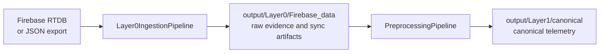
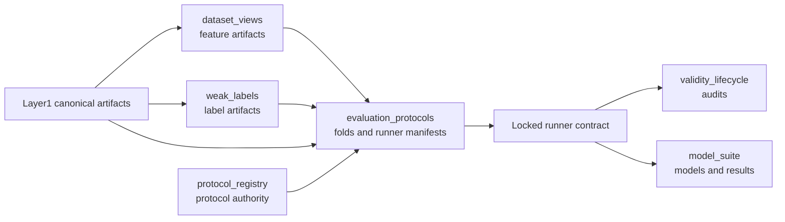

# Backend

The backend contains two related but separate lanes:

1. **Telemetry lane** — Layer0 ingestion and Layer1 canonicalization.
2. **Research lane** — dataset views, weak labels, protocol governance,
   validity audits and model execution.

The telemetry lane does not assign benchmark labels. The research lane must
not mutate Layer0 evidence or canonical Layer1 outputs in place.

## Actual package layout

```text
src/agrifusion/                     installable telemetry package (pip install -e .)
|-- cli.py                          CLI: `agrifusion` / `python -m agrifusion`
|-- settings/                       env, paths, BackendSettings
|-- io/                             storage / JSON / table helpers
|-- ingest/                         Layer0: source ingestion and raw artifacts
|-- canonical/                      Layer1: canonical telemetry processing
`-- cloud/                          Firebase RTDB client
Backend/
|-- Benchmark/                      research dataset/evaluation lanes (not packaged)
|-- main.py                         deprecated shim for `python -m Backend.main`
`-- tests/                          contract and processing tests
output/                             generated local artifacts (gitignored)
```

The Python namespace for telemetry processing is `agrifusion`
(`agrifusion.ingest`, `agrifusion.canonical`, ...). The old
`Backend.Navigation.Core` and `Backend.Config` paths no longer exist.

## Telemetry flow



### Layer0 owns

- source adapters for Firebase and JSON exports;
- latest metadata and sync decisions;
- immutable raw snapshots, history and source manifests;
- replayable local evidence.

Read [Layer0 README](../src/agrifusion/ingest/README.md) and
[Layer0 flow](../src/agrifusion/ingest/FLOW.md).

### Layer1 owns

- canonical row construction;
- sensor/context normalization and provenance;
- continuity and temporal fields;
- field catalog and governance metadata;
- canonical persistence, quality reports and compatibility views.

Read [Layer1 README](../src/agrifusion/canonical/README.md) and
[Layer1 flow](../src/agrifusion/canonical/FLOW.md).

## CLI

Run from the repository root:

```powershell
agrifusion --help
```

Examples:

```powershell
# Fetch current/full history and process Layer0 -> Layer1.
agrifusion --source firebase --node-id Node2 --full-history

# Use an exported RTDB JSON document.
agrifusion --source json-export --input-json C:\path\export.json --node-id Node2 --full-history

# Rebuild Layer1 from existing local Layer0 artifacts.
agrifusion --only-layer1

# Ingestion only.
agrifusion --only-layer0 --source firebase --node-id Node2
```

Runtime configuration comes from `Backend/.env` and CLI overrides. Important
settings include `EXPORT_SOURCE`, `EXPORT_NODE_ID`, `EXPORT_INPUT_JSON`,
sensor identity overrides and `FIREBASE_KEY_PATH`/`DATABASE_URL` for Firebase.

## Benchmark flow

The research lane consumes frozen Layer1 artifacts:



Read [Benchmark README](Benchmark/README.md),
[Backend pipeline flow](PIPELINE_FLOW.md), and the
[Benchmark-to-model handoff](Benchmark/BENCHMARK_TO_MODEL_SUITE_SPEC.md).

## Generated outputs

The main local outputs are:

- `output/Layer0/Firebase_data/**` — raw snapshots, history, sync state
  and manifests;
- `output/Layer1/canonical/**` — canonical history, latest snapshot and
  feature catalog;
- `output/Layer1/segments/**` — continuity segmentation;
- `output/Layer1/quality_reports/**` — data-quality and audit reports;
- benchmark run directories under the relevant lane's artifact root.

These outputs are derived evidence, not source code. Keep the raw source
immutable and write a new run/artifact when experimenting.

## Tests

See [Backend tests](tests/README.md). Focused examples:

```powershell
python -m unittest Backend.tests.test_layer1_packet_processors
python -m unittest Backend.tests.test_dataset_views_selection
python -m unittest Backend.tests.test_evaluation_protocols_smoke
python -m unittest Backend.tests.test_model_suite
```

## Boundaries

- `agrifusion.settings` and `agrifusion.io` are shared infrastructure, not a
  research-label owner.
- `agrifusion.ingest` / `agrifusion.canonical` preserve observed/provenance
  data and do not create benchmark targets.
- `Backend/Benchmark` owns labels, splits, leakage controls, training and
  scientific interpretation.
- The static frontend reads a separate `result/*` presentation contract; the
  current backend CLI does not automatically publish that contract.
