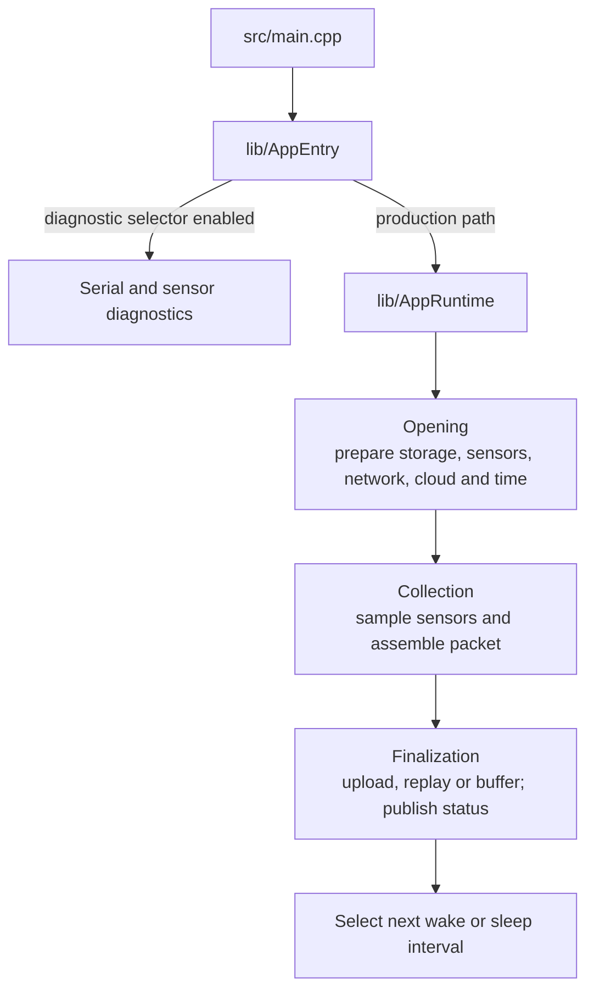

# IoT Node firmware

`IoT_Node` is the ESP32-S3 firmware lane. The current PlatformIO environment
is `esp32-s3-n16r8` and the active source entrypoint is deliberately thin:



See [FLOW.md](FLOW.md) for production status and replay semantics.

## Production path

With diagnostic selectors disabled, `AppRuntime` runs the configured wake
cycle or continuous profile. The production wake cycle is split into:

1. opening — filesystem, sensors, modem/network, cloud and time readiness;
2. collection — NPK, SHT30, DS18B20 and moisture acquisition plus packet
   assembly;
3. finalization — upload/replay/buffering, status publication and next sleep
   decision.

DS18B20 and moisture values are injected into the existing NPK-compatible
fields. They are not separate canonical telemetry branches.

## RTDB contract

The current firmware configuration identifies the node as Node2:

- `/Node2/telemetry/<date>/<event>` — dated canonical telemetry;
- `/Node2/latest/current` — newest snapshot;
- `/Node2/latest/meta` — backend synchronization metadata.

`/debug/Node2` and `/debug/Node2/npk_test/latest` are diagnostic surfaces.
Production debug publishing is disabled by default.

## Build and local configuration

```powershell
cd IoT_Node
pio run -e esp32-s3-n16r8
pio device monitor -b 115200
```

For real credentials, copy
`lib/Config/src/Config.private.example.h` to
`lib/Config/src/Config.private.h` and fill it locally. The private file is
ignored and must not be committed.

The main configuration owner is
[lib/Config/README.md](lib/Config/README.md). Mode selection and runtime
ownership are documented in [lib/AppEntry/README.md](lib/AppEntry/README.md)
and [lib/AppRuntime/README.md](lib/AppRuntime/README.md).

## Diagnostic modes

`Config.h` contains mutually exclusive compile-time selectors for SIM,
NPK, SHT30, DS18B20, moisture, combined-sensor and raw-truth probes. The
current production setup leaves all diagnostic selectors off, so the standard
`esp32-s3-n16r8` PlatformIO environment starts the Node2 `AppRuntime` wake
cycle. Set `APP_NPK_MATRIX_TEST_MODE=1` to run the serial-only, read-only NPK
Modbus matrix; return it to 0 after that test. `APP_SIM_NODE2_TEST_MODE`
remains an opt-in probe that writes to `/debug/Node2/telemetry_probe` without
sensor collection. Production telemetry uses `/Node2/telemetry`, with current
and polling metadata at `/Node2/latest/current` and `/Node2/latest/meta`. The
other sensor probes are serial/hardware diagnostics and do not prove the
production wake cycle is field-ready.

`lib/Sht30RawProbe/` currently contains a separate direct-Wire diagnostic
source, but `AppEntry` does not select or invoke it. Its README records this
unintegrated status and the exact commands currently implemented.

## Verification boundary

A successful PlatformIO build proves compilation for the selected board
profile. It does not prove sensor wiring, modem registration, Firebase rules,
deep-sleep timing or long-run field stability. Those require separate
hardware evidence. The current build log also reports the generic
`esp32-s3-devkitc-1` metadata as `ESP32-S3-DevKitC-1-N8 (8 MB QD, No PSRAM)`
while this environment is named `esp32-s3-n16r8` and applies 16 MB/PSRAM
overrides. Confirm the physical board and PlatformIO board definition before
calling the firmware deployment-ready.
