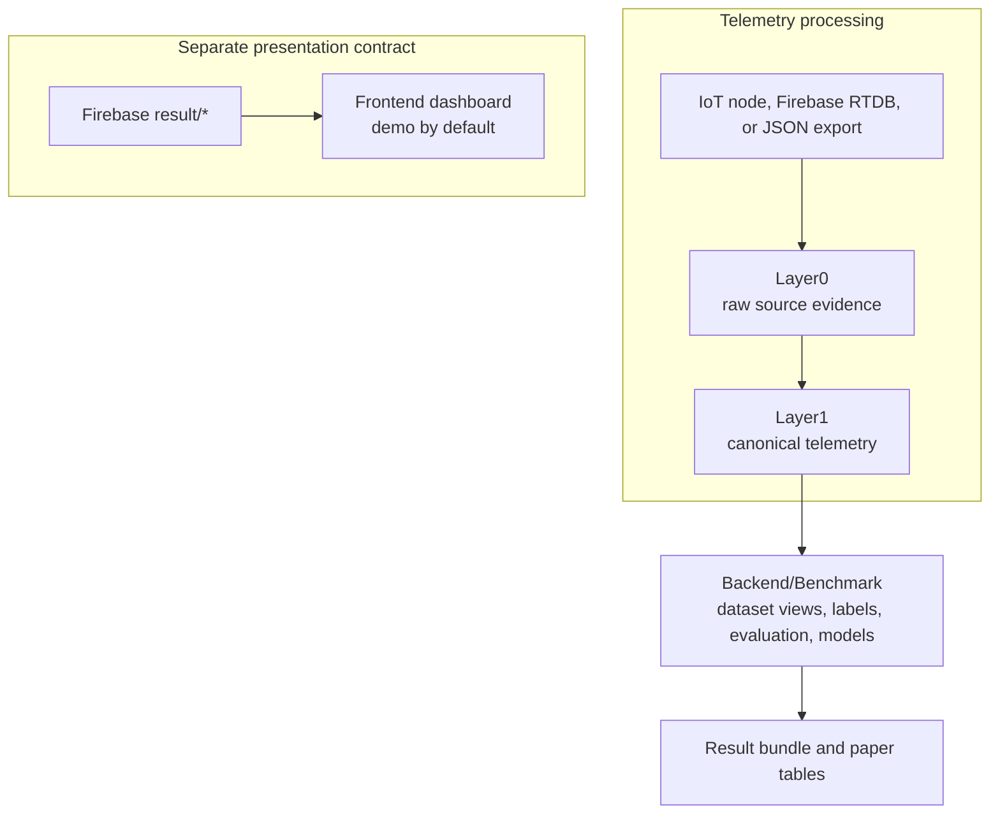

# AgriFusion-IoT

An agricultural IoT data system and research workspace: ESP32 sensor-node firmware, a pipeline that turns raw sensor records into clean, auditable "canonical" data, a benchmark for machine-learning classifiers on that sensor time series, and a static dashboard.

**Status:** research and portfolio project. Pipeline, benchmark and paper-reproducibility package are implemented; two papers are under review (below). The live dashboard connection and field deployment are not claimed.

Author: Lam-Nguyen Nguyen. CV: https://cv.lnit.id.vn

## Tóm tắt (Tiếng Việt)

- Hệ thống dữ liệu IoT nông nghiệp: firmware cho node cảm biến ESP32 (đất, nhiệt độ, độ ẩm), pipeline làm sạch và chuẩn hóa dữ liệu có lưu vết kiểm toán, bộ benchmark đánh giá mô hình học máy trên chuỗi thời gian cảm biến, và dashboard tĩnh.
- Có sẵn gói tái lập kết quả bài báo (kèm mã băm SHA-256 cho từng tệp), và bộ kiểm thử tự động cho pipeline và benchmark.
- Hai bản thảo đã nộp, đang chờ phản biện: EAI AICON 2026 và SN Computer Science. Chưa có bài nào được chấp nhận.
- Chưa có bằng chứng triển khai thực địa trong repo; dashboard mặc định chạy ở chế độ demo. Mã được viết bằng công cụ AI (Claude, Codex) theo thiết kế của tác giả, sau đó tác giả và agent kiểm tra độc lập rà soát và kiểm thử.

## What problem it solves

- Raw sensor feeds are messy (gaps, replays, outages). The pipeline keeps the raw data untouched (Layer0) and builds a cleaned, documented version with provenance (Layer1), so analysis can be traced back.
- Labels in sensor research are often guessed by rules, then treated as truth. This repo keeps weak labels, benchmark targets and model predictions separate from observed measurements, and audits how well models match the label rules.
- Results should be repeatable. The paper v1.0 analysis ships as a checksummed result bundle with a command that rebuilds the paper tables.

## What works today and what does not

Verified from code, tests and docs in this repo.

### Works today

- Telemetry pipeline: `python -m Backend.main` reads Firebase or a JSON export, writes Layer0 raw evidence and Layer1 canonical data (see [Backend README](Backend/README.md)).
- Benchmark lane: dataset views, weak labels, protocol registry, evaluation protocols (temporal folds), model suite, validity audits (see [Benchmark README](Backend/Benchmark/README.md)).
- Paper v1.0 reproducibility: result bundle of 202 files with SHA-256 manifest, source hashes for the official Stuard dataset, and a table rebuild command ([guide](Docs/research/reproducibility/paper-v1.0/README.md)). Not re-run for this README (it needs the release ZIP).
- Firmware for ESP32-S3 (PlatformIO) with wake cycle, buffering/replay and Firebase publishing ([IoT Node README](IoT_Node/README.md)). Not built or flashed for this README.
- Static dashboard in safe demo mode (no credentials needed) ([Frontend README](Frontend/README.md)).
- Tests: 213 `unittest` cases in `Backend/tests/` (they check contracts and processing logic, not Firebase or hardware). A check on 2026-11-27 in a plain Linux Python environment (pandas, numpy, scikit-learn, pyarrow) ran 213 tests: 201 passed, 2 skipped, 10 failed or errored. The causes seen: optional ML packages not installed (`pytabkit`, torch models), generated local outputs absent (`Backend/Output_data/...`), one test that asserts a Windows path (`D:/AgriFusion-IoT`), and pandas/pyarrow type differences. The failures were not investigated further and the suite was not run in the author's own environment.

### Not yet done / not verified

- The backend does not publish the Firebase `result/*` data the dashboard reads in live mode. Live dashboard integration is a separate, unbuilt boundary.
- Physical sensor, SIM, Firebase-rule and field-deployment claims have no runtime evidence in the repo.
- `requirements.txt` does not list `pyarrow`, which the tests and dataset views need for Parquet; torch is installed separately.
- No continuous integration for tests (the only workflow publishes a static page).
- Which manuscript the "WADE paper v1.0" reproducibility guide corresponds to is not stated in the repo.

## Research status

| Paper | Status |
| --- | --- |
| EAI AICON 2026 manuscript | Submitted, under review |
| "Auditing temporal sensor classifiers: target definitions, rule fidelity, and corrective decisions" (SN Computer Science, Nov 2026) | Submitted, under review |

Status only. Neither paper is accepted or published.

## Architecture



The current tracked backend does not publish `result/*`. See the [system architecture](public-docs/architecture.md) for ownership boundaries and the [backend flow](Backend/PIPELINE_FLOW.md) for benchmark handoffs.

## Quick start

From the repository root (Python; commands below are from the repo docs, PowerShell style):

```powershell
python -m pip install -e ".[dev,research]"   # installs the `agrifusion` package + CLI; drop [research] for the telemetry backend only
agrifusion --help
python -m unittest discover -s Backend/tests -p "test*.py"
```

Run Layer0 and Layer1 from Firebase or a JSON export:

```powershell
agrifusion --source firebase --node-id Node2 --full-history
agrifusion --source json-export --input-json C:\path\export.json --node-id Node2 --full-history
agrifusion --only-layer1   # node id is read from the Layer0 manifest if --node-id is omitted
```

The backend has no default node id: pass `--node-id` (or set `EXPORT_NODE_ID` in `.env`, see `.env.example`). Match the value to the source path; the firmware currently publishes Node2 data. Generated data goes to `output/` (gitignored). `python -m Backend.main` still works as a deprecated alias.

Benchmark:

```powershell
python -m Backend.Benchmark.dataset_views.main --help
python -m Backend.Benchmark.evaluation_protocols.main --help
python -m Backend.Benchmark.model_suite.cli --help
```

Start with [Backend/PIPELINE_FLOW.md](Backend/PIPELINE_FLOW.md) and the [benchmark handoff contract](Backend/Benchmark/BENCHMARK_TO_MODEL_SUITE_SPEC.md). For the frozen paper results, see the [paper reproducibility guide](Docs/research/reproducibility/paper-v1.0/README.md); it maps the release bundle to manuscript Tables 2-4 and records the official Stuard Version 2 source hashes.

Dashboard (demo mode by default; live Firebase mode needs an untracked local `Frontend/public/config.local.json`):

```powershell
python -m http.server 4173 -d Frontend/public
```

## Repository layout

```
src/agrifusion/ telemetry backend package: settings, io, ingest (Layer0), canonical (Layer1), cloud, cli
Backend/       Benchmark research lanes and tests (Backend/Benchmark moves out in a later stage)
output/        generated Layer0/Layer1 data (gitignored)
IoT_Node/      ESP32-S3 firmware (PlatformIO)
Frontend/      static Firebase RTDB dashboard (demo mode by default)
Docs/          paper reproducibility guide, diagrams, a static web page, worklogs
public-docs/   architecture and repository hygiene notes
.github/       GitHub Pages workflow
```

Read in this order: [System architecture](public-docs/architecture.md), [Repository hygiene](public-docs/repository-hygiene.md), [Backend pipeline](Backend/README.md), [Benchmark workspace](Backend/Benchmark/README.md), [IoT Node firmware](IoT_Node/README.md), [Frontend dashboard](Frontend/README.md). Full map: [`public-docs/README.md`](public-docs/README.md).

## What is intentionally not in the source contract

- `output/` (and the legacy `Backend/Output_data/`) and benchmark artifacts are generated outputs.
- `Secrets/`, `.env` files, Firebase local config and private firmware credentials are local-only.
- Physical sensor, SIM, Firebase-rule and deployment claims require explicit runtime evidence.
- Weak labels, benchmark targets and model predictions are research-derived artifacts, not observed sensor measurements.

## How it was built

Designed and directed by Lam-Nguyen Nguyen; code written with AI coding agents (Claude, Codex) under his specifications, then reviewed and tested by him and independent agent reviews.

## Contact

CV and contact: https://cv.lnit.id.vn
