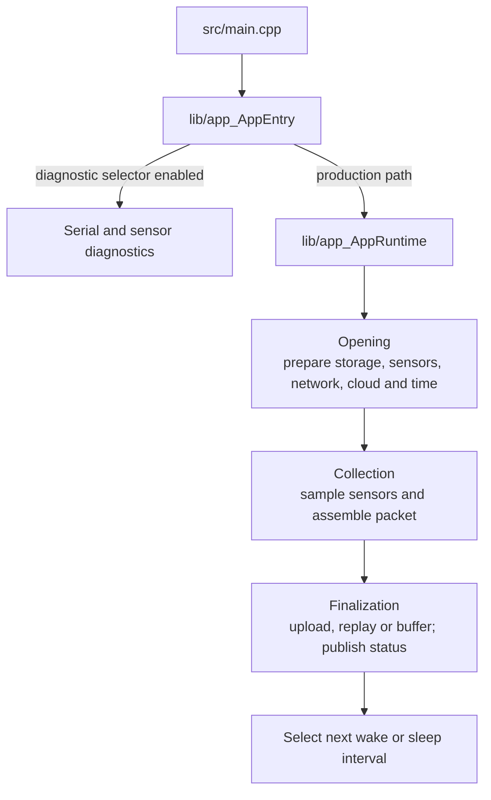

# IoT Node firmware

`firmware/` (formerly `IoT_Node/`) is the ESP32-S3 firmware lane. The current PlatformIO environment
is `esp32-s3-n16r8` and the active source entrypoint is deliberately thin:



## Production path

With diagnostic selectors disabled, `AppRuntime` runs the configured wake
cycle or continuous profile. The production wake cycle is split into:

1. opening — filesystem, sensors, modem/network, cloud and time readiness;
2. collection — NPK, SHT30, DS18B20 and moisture acquisition plus packet
   assembly;
3. finalization — upload/replay/buffering, status publication and next sleep
   decision.

DS18B20 and moisture values are injected into the existing NPK-compatible
fields. They are not separate canonical telemetry branches.

## RTDB contract

The current firmware configuration identifies the node as Node2:

- `/Node2/telemetry/<date>/<event>` — dated canonical telemetry;
- `/Node2/latest/current` — newest snapshot;
- `/Node2/latest/meta` — backend synchronization metadata.

`/debug/Node2` and `/debug/Node2/npk_test/latest` are diagnostic surfaces.
Production debug publishing is disabled by default.

## Build and local configuration

```powershell
cd firmware
pio run -e esp32-s3-n16r8
pio device monitor -b 115200
```

For real credentials, copy
`lib/config_Config/src/Config.private.example.h` to
`lib/config_Config/src/Config.private.h` and fill it locally. The private file is
ignored and must not be committed.

The main configuration owner is
[lib/config_Config/README.md](lib/config_Config/README.md). Mode selection and runtime
ownership are documented in [lib/app_AppEntry/README.md](lib/app_AppEntry/README.md)
and [lib/app_AppRuntime/README.md](lib/app_AppRuntime/README.md).

## Layout

PlatformIO scans only one level under `lib/`, so roles are encoded as folder
prefixes instead of nested directories:

| Prefix | Libraries |
|---|---|
| `app_` | AppEntry, AppRuntime, DeviceContext |
| `sensors_` | NPK, Sht30Service, Ds18b20Service, SoilMoistureService (includes the former Soilv2) |
| `transport_` | Sim (includes former SimHttpClient and SimSocketTransport), NetworkBridge, WifiManager, TransportStability, DateTime, RtdbRestClient |
| `publish_` | FirebasePipeline, NodeRuntimePublisher, RawTelemetryReporter, NodePacketBuilder |
| `config_` / `storage_` | Config, Storage |

Known duplication not merged: the four `publish_*` libs plus
`transport_RtdbRestClient` all take part in building a packet and writing it to
RTDB (about 3.3k lines), and `FirebaseESP32.h` types still appear in the
signatures of AppRuntime, FirebasePipeline, NodeRuntimePublisher and
RawTelemetryReporter although the production transport is the SIM REST client.
Merging needs a build and hardware regression run, so it was left alone.

## Node identity

`NODE_ID` in `lib/config_Config/src/Config.h` is the single source for the node
id and all RTDB paths (`/<NODE_ID>/...`, `/debug/<NODE_ID>/...`). Override with
`-DNODE_ID=\"Node3\"` if needed. The backend has no default node id: pass
`--node-id` (or set `EXPORT_NODE_ID`) to match.

## Diagnostic probes

Probes live in `tools/probes/` and have their own PlatformIO envs, which extend
the production env and set one `-D` flag each (no editing of `Config.h`):

`probe_sht30`, `probe_ds18b20`, `probe_soil_moisture`, `probe_all_sensors`,
`probe_raw_truth`, `probe_sim_pure`, `probe_npk_matrix`.

```powershell
pio run -e probe_sht30 -t upload
```

`probe_npk_matrix` uses a new minimal entry
(`tools/probes/NpkMatrixTest/entry/main.cpp`); the old driver sketch is in
branch `snapshot/pre-refactor-2026-11`. These modes are for serial/hardware
diagnosis and do not prove that the production wake cycle is field-ready.

## Removed

OTA removed (OtaManager, OtaBootGuard, OtaStateStore, OtaRtdbReporter and the
OTA constants in `Config.h`): never included by the build and still pointed at
`Node1`. Available in branch `snapshot/pre-refactor-2026-11`. Also removed: root
`main.cpp` (`#if 0`, not built) and the legacy `SHT30` lib. Unused deps
`PubSubClient` and `StreamDebugger` dropped from `platformio.ini`, together with
the machine-specific `-IC:/Users/...` include flags.

## Verification boundary

A successful PlatformIO build proves compilation for the selected board
profile. It does not prove sensor wiring, modem registration, Firebase rules,
deep-sleep timing or long-run field stability. Those require separate
hardware evidence. The current build log also reports the generic
`esp32-s3-devkitc-1` metadata as `ESP32-S3-DevKitC-1-N8 (8 MB QD, No PSRAM)`
while this environment is named `esp32-s3-n16r8` and applies 16 MB/PSRAM
overrides. Confirm the physical board and PlatformIO board definition before
calling the firmware deployment-ready.
