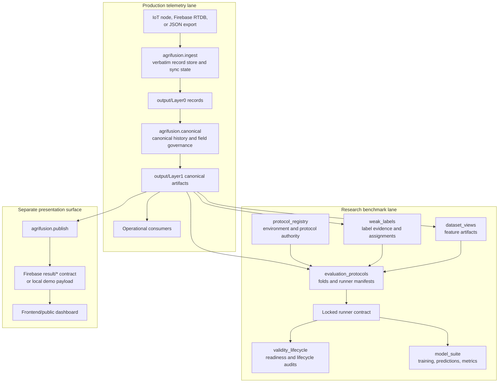

# System architecture

AgriFusion-IoT has two connected processing lanes and one presentation
surface. The lanes share data contracts, but they do not share ownership of
the same artifacts.

The frontend contract is separate from Layer1, and `agrifusion.publish` is the
only bridge between them (see [Frontend surface](#frontend-surface)). For detailed implemented handoffs,
including optional external-dataset and pre-train audit paths, see the
[Backend Pipeline Flow](../Backend/PIPELINE_FLOW.md).
Paths below are relative to the repository root.

## Operational telemetry lane

### Edge

`firmware/src/main.cpp` delegates to `firmware/lib/app_AppEntry`. The current
production path is `AppEntry -> AppRuntime`, which coordinates sensor
collection, transport readiness, buffering/replay and RTDB publication.

The current firmware configuration targets Node2 and publishes canonical
telemetry under:

- `/Node2/telemetry/<date>/<event>` — dated telemetry records;
- `/Node2/latest/current` — newest snapshot;
- `/Node2/latest/meta` — polling metadata for backend synchronization.

Diagnostic paths under `/debug/Node2` are disabled by default and must not be
treated as the production source of truth.

### Backend

The backend is the installable package `src/agrifusion` (CLI: `agrifusion`):

- `ingest` (Layer0) loads Firebase or JSON-export input and stores every
  record verbatim in a hashed, immutable record store under `output/Layer0`.
- `canonical` (Layer1) converts stored records into the canonical history
  contract and writes reports, quality views and compatibility outputs under
  `output/Layer1`.
- `cloud` is the Firebase RTDB client, `publish` writes the dashboard contract
  (below), `settings` owns runtime settings, environment loading and paths, and
  `io` holds table/JSON storage helpers.
- `Backend/` now only holds the tests (`Backend/tests`) and a deprecated
  `python -m Backend.main` shim.

The backend accepts a logical `--node-id`; it is not hard-coded to Node2.
When reading the firmware described above, configure the backend with the
matching node id instead of relying on the default.

## Research benchmark lane

The benchmark lane (`research/agrifusion_research`, sub-packages under
`core/`, `external/` and `experiments/`) starts from frozen Layer1 canonical
artifacts. Its owners are:

| Lane | Owns | Does not own |
| --- | --- | --- |
| `dataset_views` | feature-view materialization | labels or model training |
| `weak_labels` | evidence, weak-label authority and provenance | raw telemetry mutation |
| `protocol_registry` | protocol/environment authority | downstream model fitting |
| `evaluation_protocols` | folds, domains and runner manifests | changing source labels in place |
| `validity_lifecycle` | readiness and lifecycle audits | creating an unrelated split |
| `model_suite` | model execution, metrics and reports | redefining the benchmark contract |

The handoff is file-based and versioned. The central contract is described in
[Benchmark to Model Suite](../research/agrifusion_research/core/BENCHMARK_TO_MODEL_SUITE_SPEC.md).

## Frontend surface

`Frontend/public` consumes `result/*` from Firebase when configured for live
mode, and otherwise renders a deterministic demo payload. The contract is
[`docs/contracts/result.md`](../docs/contracts/result.md).

The publisher exists: `src/agrifusion/publish`, run as `agrifusion publish`
(dry-run by default, `--apply` writes). It is tested against the contract with a
fake client. It has not been run against live Firebase yet; that needs the
owner's service account. Until then the dashboard must not be described as
verified live output of the backend.
